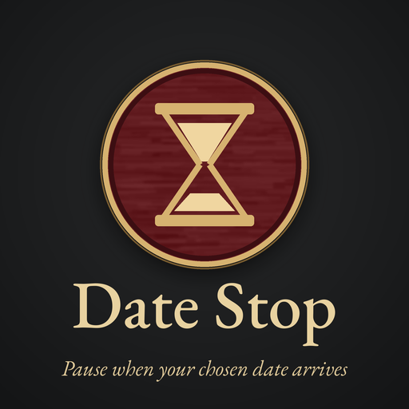

# Date Stop (Crusader Kings III)

Pick dates, and the game pauses when each one arrives. A clock icon in the time bar, left of the date, opens the panel.

Port of the [Victoria 3 Date Stop](https://github.com/keanfreeman/victoria3-date-stop) mod.

<!-- Add the Steam Workshop link here after publishing. -->

## Usage

1. Click the clock icon left of the date in the bottom bar.
2. Pick a date with the Year / Month / Day − and + buttons (Year ±1/±10, Day ±1/±5; days and months carry over). The quick buttons (**Today**, +1w, +1m, +3m, +6m, +1y, +5y, +10y) add to the chosen date and can be clicked repeatedly.
3. Optionally click the **Reason** button and choose one of 36 presets (Truce ends, Pregnancy due, Siege, Council task, Save the game, ...). The ✕ beside it clears the reason.
4. Click **Set stop**. The date must be in the future and not already set.

Up to 6 stops are listed under the buttons, each with its reason. The ✕ beside a stop removes it, and **Clear all** removes every stop and the chosen reason. When a date arrives the game pauses and a popup lists the reasons of the stops that fired.

Reasons are presets because a mod can't save typed text in a save game.

Stops belong to your player character and move with you when you switch characters, such as on succession.

## Compatibility

- Built for Crusader Kings III 1.20 (Crozier).
- Safe to add to an existing save. It replaces no vanilla files, so it should work alongside other mods, including UI mods.
- Multiplayer: each player sets their own stops. The mod is marked as multiplayer-synchronized, but this hasn't been tested.
- English only. Other languages show the English text.

## Manual install

Run `tools/install.sh`. It copies `mod/` to `~/.local/share/Paradox Interactive/Crusader Kings III/mod/Date Stop` and writes `date_stop_ck3.mod` beside it, which the CK3 launcher needs to list the mod. On Windows, copy `mod/` to `Documents/Paradox Interactive/Crusader Kings III/mod/Date Stop`, and create `Documents/Paradox Interactive/Crusader Kings III/mod/date_stop_ck3.mod` containing the contents of `mod/descriptor.mod` plus a `path="..."` line pointing at that folder.

## How it works

- **Widget:** `gui/scripted_widgets/dsc_widgets.txt` creates the widget at game start.
- **State:** character variables on the player (`dsc_a1`..`dsc_a6`, key = `year*10000 + month*100 + day`), because the GUI can only read character variables. Reasons are flags.
- **Daily check:** CK3 has no daily on_action, so a hidden event (`date_stop.1`) reschedules itself every day while any stop exists.
- **Pausing:** the event sets `dsc_pause_pending`. A GUI `state` watches that flag, calls `OnPause`, then clears it.
- **Player change:** `on_player_character_change` hands the stops to the new character and restarts the check. Duplicate chains stop themselves.

## Development

- `mod/` is exactly what ships, but most of it is generated. Edit `tools/gen.py` (slot count `N` and the `REASONS` list are at the top), run `python3 tools/gen.py`, then `tools/install.sh`.
- The icon's position is the `position = { -420 1 }` line in `tools/gen.py`.
- `tools/make_thumbnail.py` draws `mod/thumbnail.png`. It needs Pillow and the EB Garamond font from a Victoria 3 install (`VIC3_DIR` overrides the path).
- Errors from the mod show in `~/.local/share/Paradox Interactive/Crusader Kings III/logs/error.log` (search for `dsc` and `date_stop`).

## License

[MIT](LICENSE)
